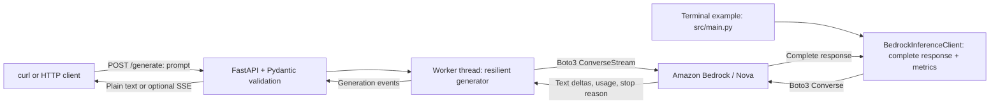

# GenAI Operations Assistant

A Python prototype for generating operations guidance with Amazon Bedrock.
Submit an incident description through a streaming HTTP API, or run a
terminal example that waits for the complete response using Converse.

## Problem and scope

During an incident, waiting for a complete generated answer delays the first
useful suggestion. This project explores how to deliver that answer
incrementally, handle interrupted generation without silently replaying
partial answers, and inspect streaming behavior across models and HTTP
protocols.

The current application works with the context supplied in a prompt. It
has no connection to production logs, metrics, deployments, or runbooks,
and does not execute remediation. Treat generated steps as suggestions to
review against the actual incident. The repository is a local development
prototype, not an autonomous operations agent.

## Architecture



The API's server is Uvicorn for HTTP/1.1 or Hypercorn for HTTP/2 and HTTP/3.
Protocol selection changes the client-to-API connection; the separate
Boto3-to-Bedrock connection is unchanged. Bedrock determines the incoming
text deltas, which may contain multiple tokens.

| Component | Responsibility |
| --- | --- |
| `src/api.py` | Validate requests, obtain a cached Boto3 client, serialize streaming responses |
| `src/ops_assistant/resilient_stream.py` | Translate Bedrock events, retry eligible failures, report completion/errors, close streams |
| `src/ops_assistant/server.py` | Select protocol, bind address, and TLS configuration |
| `src/ops_assistant/bedrock_client.py` | Call Converse and return complete text, token usage, stop reason, and total latency |
| `src/main.py` | Run a fictional incident prompt and print the completed response plus metrics |
| `tests/` | Verify API streaming, complete CLI responses, errors, and server configuration using fake runtimes |
| `hypercorn.toml` | Optional direct Hypercorn configuration, separate from the runtime launcher |

## Design decisions

- **Separate inference interfaces:** the API uses `converse_stream` to forward
  text before generation finishes. The CLI client uses `converse` and returns
  a complete response; it has no text callback or chunk timing measurements.
- **Plain text by default:** simple clients receive only model output. An
  optional SSE format adds explicit start, text, completion, and error events.
- **Blocking SDK off the event loop:** the API advances Boto3's synchronous
  iterator in a worker thread, leaving the async event loop available to
  handle HTTP work. Stream cleanup runs when iteration finishes or is closed.
- **Retries before text only:** the API generator allows up to three
  application attempts for selected service/network failures, using
  exponential backoff with jitter. Once text has been emitted, it reports
  interruption rather than restarting and duplicating the response. SDK
  request retries are separate from this application loop.
- **Separate API and measurement paths:** the API defaults to Nova Micro,
  `maxTokens=300`, and `temperature=0.2`. The CLI client defaults to Nova Lite,
  `maxTokens=2048`, and `temperature=0.5`. These parameters are currently set
  in code; set the same model and parameters before comparing performance.
- **HTTP/1.1 first:** no certificate is needed for the default local setup.
  HTTP/2 and HTTP/3 are optional TLS modes for transport experiments, with
  fallback for compatible clients. They do not guarantee faster inference.
- **Injected runtimes:** unit tests substitute fake Bedrock clients, keeping
  the test suite independent of AWS credentials, model availability, and costs.

## Local setup

Prerequisites: Git, Python 3.12 or newer (the repository pins 3.12), and
[uv](https://docs.astral.sh/uv/getting-started/installation/). AWS CLI v2 is
useful for credential setup and identity checks. OpenSSL and a compatible
curl build are needed for the optional TLS/HTTP/3 examples below.

After cloning the repository, enter its root directory and install the
locked dependencies plus development tools:

```sh
cd genai-operations-assistant
uv sync --locked --dev
.venv/bin/python -m pytest
```

Tests use fake AWS runtimes and can run before configuring credentials.
For HTTP/2 and HTTP/3 support, install the optional dependencies as well:

```sh
uv sync --locked --dev --extra http3
```

### AWS prerequisites

You need an AWS account with billing enabled, valid credentials for the
intended account, and access to a streaming-capable Bedrock model in your
chosen Region. Check the model's regional availability and inference mode;
some model/Region combinations require an inference profile rather than a
bare model ID. See the [Nova Micro model details](https://docs.aws.amazon.com/bedrock/latest/userguide/model-card-amazon-nova-micro.html)
and [Bedrock model access requirements](https://docs.aws.amazon.com/bedrock/latest/userguide/model-access.html).

The API identity needs `bedrock:InvokeModelWithResponseStream`; the CLI
identity needs `bedrock:InvokeModel` for its selected model. Here is an example policy for direct invocation of the two
models used by this project in `us-east-1`:

```json
{
  "Version": "2012-10-17",
  "Statement": [
    {
      "Effect": "Allow",
      "Action": ["bedrock:InvokeModel", "bedrock:InvokeModelWithResponseStream"],
      "Resource": [
        "arn:aws:bedrock:us-east-1::foundation-model/amazon.nova-micro-v1:0",
        "arn:aws:bedrock:us-east-1::foundation-model/amazon.nova-lite-v1:0"
      ]
    }
  ]
}
```

Adapt the Region and resources to your deployment. Inference profiles,
organization policies, and provider-specific activation requirements can
require additional configuration; this example covers direct model
invocation only. See [AWS inference prerequisites](https://docs.aws.amazon.com/bedrock/latest/userguide/inference-prereq.html)
and the [ConverseStream API reference](https://docs.aws.amazon.com/bedrock/latest/APIReference/API_runtime_ConverseStream.html).
For CLI invocation, see the [Converse documentation](https://docs.aws.amazon.com/boto3/latest/reference/services/bedrock-runtime/client/converse.html).

Use an existing AWS credential profile or an IAM Identity Center session.
For example, with an already configured SSO profile named `development`:

```sh
aws sso login --profile development
export AWS_PROFILE=development
export AWS_REGION=us-east-1
aws sts get-caller-identity
```

The identity check confirms credentials, not Bedrock model permissions.
Boto3 uses its [standard credential provider chain](https://docs.aws.amazon.com/boto3/latest/guide/credentials.html);
deployed workloads can use an attached IAM role. Keep credentials out of
source files and Git. Prompts are sent to AWS for inference; use fictional
or approved incident data during development.

### Configuration

| Setting | Default | Effect |
| --- | --- | --- |
| `AWS_PROFILE` | SDK profile resolution | Select a local AWS credential profile |
| `AWS_REGION` | `us-east-1` | Bedrock runtime Region |
| `BEDROCK_MODEL_ID` | API: `amazon.nova-micro-v1:0`; CLI: `amazon.nova-lite-v1:0` | Model ID or supported inference profile |
| `STREAM_EVENT_METADATA` | `false` | Set to `true` for API SSE events and metadata |
| `--http-version` | `1` | API launcher protocol mode: `1`, `2`, or `3` |
| `--host` | `127.0.0.1` | API listener address |
| `--port` | `8000` for mode 1; `8443` for modes 2/3 | API listener port |
| `--certfile`, `--keyfile` | `.certs/localhost-cert.pem`, `.certs/localhost-key.pem` under the project root | TLS files for modes 2/3 |

Environment settings must be present when the process starts. For example,
select Nova Lite for the API with:

```sh
BEDROCK_MODEL_ID=amazon.nova-lite-v1:0 .venv/bin/python src/api.py
```

For the terminal example with a complete response, total request latency,
input/output/total token counts, and stop reason:

```sh
.venv/bin/python src/main.py
```

The installed `genai-operations-assistant` console command currently prints
a placeholder greeting; use the script commands documented here.

## Select the HTTP protocol

The API launcher accepts `--http-version 1`, `2`, or `3`. HTTP/1.1 is the
default and needs no certificate. HTTP/2 and HTTP/3 use HTTPS and require TLS
certificates plus the optional server dependencies:

```sh
uv sync --extra http3
```

The `http3` extra includes Hypercorn for both HTTP/2 and HTTP/3.

| Option | Server | Default address | Transport |
| --- | --- | --- | --- |
| `1` (default) | Uvicorn | `http://127.0.0.1:8000` | HTTP/1.1 over TCP |
| `2` | Hypercorn | `https://127.0.0.1:8443` | HTTP/2 over TLS/TCP, HTTP/1.1 fallback |
| `3` | Hypercorn | `https://127.0.0.1:8443` | HTTP/3 over QUIC/UDP, HTTP/2 and HTTP/1.1 over TLS/TCP fallback |

Choose one launch command below. Stop the previous server before changing
modes on the same port. Use `--host` and `--port` to override the address.
These options select the client-to-API transport; Boto3's connection to
Bedrock and model chunk sizes are unaffected.

### HTTP/1.1 (default)

```sh
.venv/bin/python src/api.py
```

Equivalent explicit selection:

```sh
.venv/bin/python src/api.py --http-version 1
```

Test streaming from a second terminal:

```sh
curl --http1.1 -N http://127.0.0.1:8000/generate \
  -H 'Content-Type: application/json' \
  -d '{"prompt":"Give three safe diagnostic steps for elevated HTTP 500 errors."}'
```

### TLS setup for HTTP/2 and HTTP/3

Create a self-signed certificate for local development (requires OpenSSL).
Run once; rerunning replaces the key and certificate:

```sh
mkdir -p .certs
openssl req -x509 -newkey rsa:2048 -nodes \
  -keyout .certs/localhost-key.pem \
  -out .certs/localhost-cert.pem \
  -days 30 -subj '/CN=localhost' \
  -addext 'subjectAltName=DNS:localhost,IP:127.0.0.1'
chmod 600 .certs/localhost-key.pem
```

The launcher finds the default certificate files relative to the project
root. To use different files, pass `--certfile /path/to/cert.pem` and
`--keyfile /path/to/key.pem`. Missing or invalid TLS files produce a startup
error with setup guidance. Keep private keys out of Git; `.certs/` is ignored.

### HTTP/2

```sh
.venv/bin/python src/api.py --http-version 2
```

Request HTTP/2 and display the negotiated version after the streamed text:

```sh
curl --http2 --cacert .certs/localhost-cert.pem -N \
  https://127.0.0.1:8443/generate \
  -H 'Content-Type: application/json' \
  -d '{"prompt":"Give three safe diagnostic steps for elevated HTTP 500 errors."}' \
  -w '\nHTTP version: %{http_version}\n'
```

Check that the printed version is `2`; `--http2` permits fallback.

### HTTP/3 over QUIC

```sh
.venv/bin/python src/api.py --http-version 3
```

Use an HTTP/3-capable curl build to require QUIC:

```sh
/opt/homebrew/opt/curl/bin/curl --http3-only \
  --cacert .certs/localhost-cert.pem -N \
  https://127.0.0.1:8443/generate \
  -H 'Content-Type: application/json' \
  -d '{"prompt":"Give three safe diagnostic steps for elevated HTTP 500 errors."}' \
  -w '\nHTTP version: %{http_version}\n'
```

On macOS, `brew install curl` provides a separate curl installation; check
`/opt/homebrew/opt/curl/bin/curl --version` for `HTTP3`. The system curl may
lack it. Adjust the executable path if Homebrew is installed elsewhere.

The curl certificate paths above are relative to your terminal's current
directory. Run from the project root or pass an absolute certificate path.
For browser use, trust the development certificate locally or use a trusted
certificate. External hosting requires an appropriate bind address, a trusted
certificate, and TCP access; HTTP/3 additionally requires UDP access on the
chosen port. Hypercorn advertises QUIC availability using `Alt-Svc`.

The earlier `hypercorn.toml` remains available for direct Hypercorn launches;
it is independent of the launcher options:

```sh
.venv/bin/python -m hypercorn --config hypercorn.toml src/api.py:app
```

## Model text and optional SSE metadata

All protocol modes stream only model output as `text/plain` by default,
without event names, JSON wrappers, or metadata. To include server-sent
events (SSE), set `STREAM_EVENT_METADATA=true` at launch, for example:

```sh
STREAM_EVENT_METADATA=true .venv/bin/python src/api.py
STREAM_EVENT_METADATA=true .venv/bin/python src/api.py --http-version 2
STREAM_EVENT_METADATA=true .venv/bin/python src/api.py --http-version 3
```

Choose one of these commands. The option is read at startup; restart after
changing it. SSE mode returns `text/event-stream` with `start`, `text`, and
`complete` events, or an `error` event if generation fails. Each `text` event
contains an incremental chunk in its JSON `text` field. The `complete` event
includes token usage and the stop reason. Errors after streaming starts are
reported as SSE events rather than a new HTTP status.

In default text-only mode, generation failures terminate the transfer and
are logged on the server; error metadata is not appended to model output.
Once response headers have been sent, the HTTP status cannot be changed.

Clients must consume responses incrementally. `curl -N` disables output
buffering. Browser clients should use `fetch()` with a response body reader
and decode incoming bytes incrementally; in SSE mode, also parse frames
separated by a blank line. Calling `response.text()` or `response.json()`
waits for the complete response. Native `EventSource` uses GET and cannot
directly call this POST endpoint.

## API contract

`POST /generate` accepts a JSON body with one `prompt` string. Pydantic
requires 1–8,000 characters and at least one non-whitespace character;
invalid input returns HTTP 422. This is a character limit, not a token budget.
Each request starts a fresh, single-user message without conversation history.
Interactive API documentation is available at `/docs` on the selected server.

With `STREAM_EVENT_METADATA=true`, the response includes frames such as:

```text
event: text
data: {"kind": "text", "attempt_id": "...", "text": "Inspect deployment changes.", "code": null, "input_tokens": null, "output_tokens": null, "stop_reason": null}

```

Each frame ends with a blank line. A `complete` event carries the final
input/output token counts and stop reason. `GENERATION_FAILED` means the
request failed before text was emitted; `GENERATION_INTERRUPTED` means the
client may already have received part of an answer. The event identifier
correlates events within a request; it does not provide resumable delivery.

## Costs

Running the local server does not itself provision AWS compute or a database.
Actual model requests incur Bedrock inference charges according to the model,
Region, and inference mode. For text on-demand inference, estimate token cost
using the current input/output rates on the [Amazon Bedrock pricing page](https://aws.amazon.com/bedrock/pricing/):

```text
request cost = (input tokens / 1,000,000 × input price per million)
             + (output tokens / 1,000,000 × output price per million)
```

For example, 1,000 requests averaging 500 input tokens and 300 output tokens
consume 0.5 million input tokens and 0.3 million output tokens. Multiply those
quantities by the selected model's rates; this is a usage illustration, not
a quoted price. Convert rates to the same token unit before calculating.

The API caps generated output at 300 tokens per application attempt; the CLI
caps it at 2,048. These are ceilings, not guaranteed output sizes. Streaming
text and SSE frames are not token counts. Retries may cause additional
inference work, and a client disconnect is not a guarantee of zero further
billing. The application does not calculate dollar costs or enforce a spend
budget. Use AWS billing tools to track actual charges, especially when
exposing the endpoint to additional clients.

Hosting the server remotely can add compute, networking, logging, proxy,
and other infrastructure charges. The unit tests use fake runtimes and do
not invoke Bedrock.

## Limitations and operational considerations

- **Generated guidance only:** no retrieval, runbook grounding, live
  telemetry, tool execution, or remediation approval workflow is implemented.
  Answers can be incomplete or incorrect and require operator review.
- **Local prototype:** no API authentication, authorization, rate limiting,
  tenant isolation, persistent history, or deployment automation is included.
  The default listener is loopback; review these gaps before external hosting.
- **Partial-response failures:** after HTTP headers are sent, failures cannot
  change the status code. Plain-text mode terminates the transfer; SSE mode
  communicates an error event. Neither mode resumes interrupted generations.
- **Limited resilience:** retries cover selected errors before text only.
  Bedrock quotas, throttling, model access, and regional capacity still apply.
  There is no application circuit breaker or overall request deadline.
- **Blocking upstream reads:** worker threads keep Boto3 off the event loop,
  but reads and retries can delay disconnect cleanup. No concurrency limit or
  load testing establishes a supported production throughput.
- **Different inference paths:** the CLI uses non-streaming Converse and its
  own SDK timeout/retry configuration. The API generator continues streaming
  and uses its separate retry policy. API SSE completion includes input/output
  token counts and stop reason; the CLI also reports total tokens and latency.
- **Timing scope:** CLI `latency_ms` measures the full Converse call at the
  Python client, including network effects and SDK retries. It does not
  measure time to first token, chunk arrivals, or isolated model compute time.
- **Transport dependencies:** HTTP/3 requires working UDP, TLS, and a compatible
  client. HTTP/2 and HTTP/3 modes retain TCP fallback, so verify the negotiated
  version. Proxies and clients may buffer output despite application streaming.
- **Development TLS:** self-signed certificates expire after 30 days and are
  not automatically trusted by browsers. They are not a production PKI setup.
- **Validation limits:** tests cover selected paths with fake runtimes; they
  do not establish live model quality, AWS billing accuracy, or end-to-end
  reliability under service failures.

## Tests

Run without live AWS calls:

```sh
.venv/bin/python -m pytest
```
